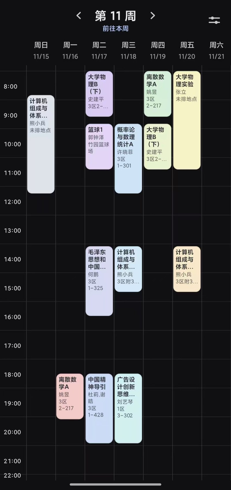
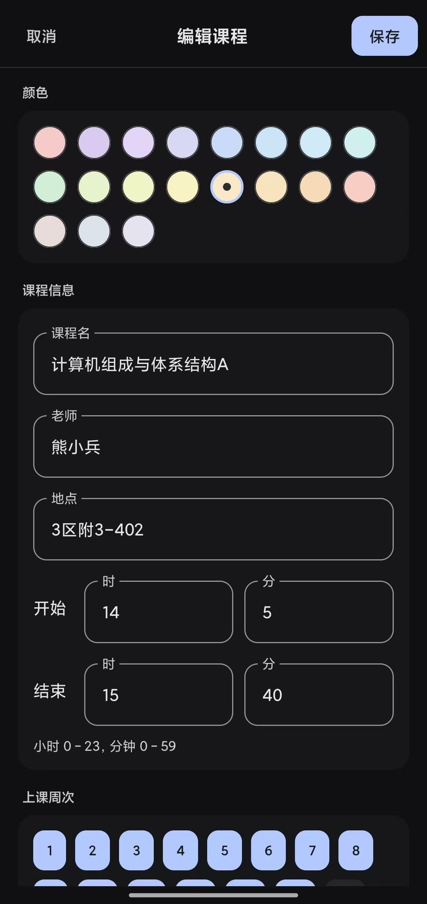

# Hamenda

一款适用于WHUER的仿Ham课程表的日程安排软件，可以自由规划课外时间，支持从武大教务系统导入课表，主打轻量、快速、数据存于本地

## 效果图

  
  

## 功能

- 长按空白处新建；按住课程再拖可以改时间、跨天（吸附到节次格子，撞车不落地）
- 左右滑动切换周，压在课程上也能滑；翻到别的周时顶栏有「前往本周」；顶栏箭头可在设置中关闭
- 左侧刻度点击切换：整点 → 第几节 → 上下课时间
- 周数按开学日期推算，单双周、1–25 周
- 跟随系统 / 浅色 / 深色主题，六种主题色
- 周起始日（周日/周一）、5 天/7 天显示、每日时间范围可调
- JSON 导出 / 导入备份
- 从教务系统导入：内嵌教务登录页，登录后自动取本学期课表，覆盖现有课程

## 下载

[Releases](https://github.com/hh12356/Hamenda/releases) 下载 APK，支持 Android 8.0（API 26）及以上。  
(仅支持安卓)

## 数据与隐私

课程数据保存在应用私有目录的 `hamenda.json`，不上传，没有通知和后台服务。只有「从教务系统导入」会联网：在内嵌的教务页面里登录并取课表，账号密码由教务页面直接提交，应用既不读取也不保存。

## License

[MIT](LICENSE)
